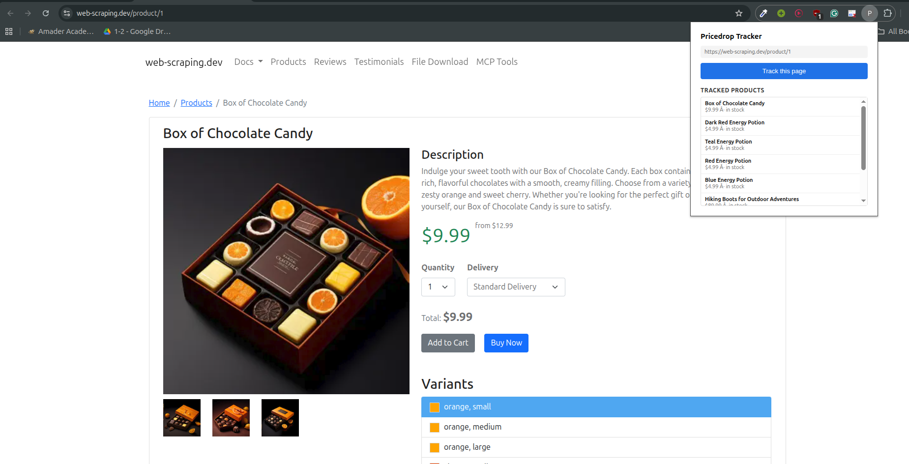
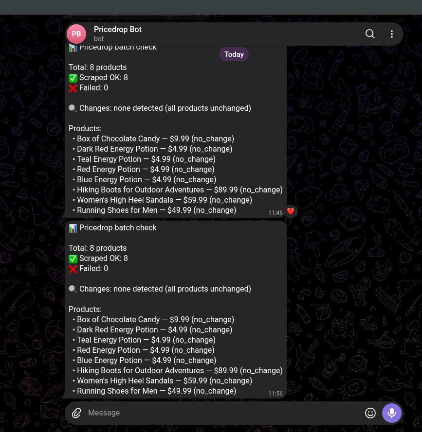
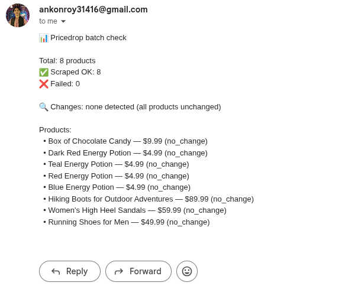
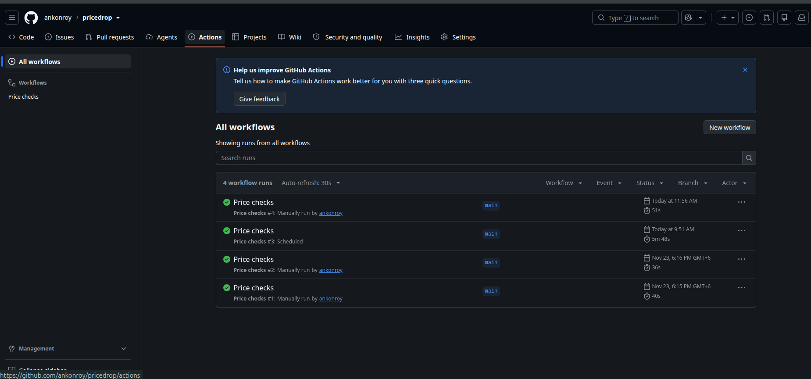

# Pricedrop — Automated Web Price Monitor

> A Chrome extension + Playwright scraper that tracks product prices and alerts you via Telegram & email when they change.

## What it does

Pricedrop is a self-hosted price monitor. Click a button on any product page → the tool tracks it → runs every 6 hours on GitHub Actions (free) → sends you a Telegram message and email the moment the price changes.

Built for real-world reliability, not tutorials:

- **Fails loudly** on broken selectors — no silent DBs full of `None`
- **Alerts only on change** — no spam, but a "heartbeat" summary every run so you know it's alive
- **Append-only history** — every scrape is preserved
- **Runs for free forever** on GitHub Actions

## Screenshots

### Chrome extension — one-click tracking

### Telegram + email alerts

| Telegram                                           | Email                                        |
| -------------------------------------------------- | -------------------------------------------- |
|  |  |

### GitHub Actions — runs every 6 hours, for free

| Green workflow                                            |
| --------------------------------------------------------- |
|  |

<!-- ### REST API (auto-generated Swagger UI)

 -->

## Architecture

    ┌────────────────────┐
    │  Chrome Extension  │  User clicks "Track this page"
    │  (popup.html/js)   │  POST /products {url}
    └─────────┬──────────┘
              │
              ▼
    ┌────────────────────┐
    │  FastAPI Backend   │  Receives URL, validates, saves
    │  (backend/app.py)  │  Returns product JSON
    └─────────┬──────────┘
              │
              ▼
    ┌────────────────────┐
    │  Playwright        │  Launches headless Chromium
    │  Scraper           │  Navigates → extracts → cleans
    │  (worker/scraper)  │  Site-specific parsers
    └─────────┬──────────┘
              │
              ▼
    ┌────────────────────┐
    │  SQLite            │  products table (one per product)
    │  (data/prices.db)  │  price_history table (append-only)
    └─────────┬──────────┘
              │
              ▼
    ┌────────────────────┐
    │  Change Detection  │  7 typed events: price_drop, price_rise,
    │  (worker/diff.py)  │  out_of_stock, back_in_stock, currency_change,
    │                    │  no_change, first_seen
    └─────────┬──────────┘
              │ (only on real changes)
              ▼
    ┌────────────────────┐
    │  Alerts            │  Telegram Bot API
    │  (worker/alerts)   │  Gmail SMTP
    └────────────────────┘

    Scheduler (parallel path):
    ┌────────────────────┐
    │  GitHub Actions    │  Cron: every 6 hours (free)
    │  (.github/...)     │  Runs worker/run_checks.py
    │                    │  Commits updated DB back to repo
    └────────────────────┘

## Features

### Core

- 🎯 **One-click tracking** — from any product page via the Chrome extension
- 🔄 **Scheduled checks** — every 6 hours via GitHub Actions (100% free for public repos)
- 🚨 **Multi-channel alerts** — Telegram + Gmail, both optional
- 📊 **Full price history** — append-only `price_history` table; nothing overwritten
- 🔍 **Change detection** — 7 typed events (drops, rises, out-of-stock, back-in-stock, currency change)

### Reliability

- 🔁 **Retry with exponential backoff** — 3 attempts, 1s → 2s → 4s between
- 🛡️ **Schema drift detection** — if the site changes its HTML, you get an error alert instead of silent corruption
- 📝 **Structured JSON logs** — every event is machine-parseable
- 🚫 **Fails loudly** — never returns `None` for a required field; raises `ScrapeFailed`
- 🧱 **Per-product isolation** — one product failing doesn't kill the batch
- 💓 **Heartbeat notifications** — one summary message per run, even if nothing changed

### Developer experience

- 🧩 **Per-site parser pattern** — add a new site by implementing one method
- 🔌 **REST API** — every operation available via HTTP
- 📖 **Auto-generated API docs** — visit `/docs` for Swagger UI

## Tech stack

| Layer             | Tech                             |
| ----------------- | -------------------------------- |
| Automation        | Playwright (Python)              |
| HTTP API          | FastAPI + Uvicorn                |
| Validation        | Pydantic                         |
| Storage           | SQLite (single file, zero setup) |
| Scheduling        | GitHub Actions (cron)            |
| Alerts            | Telegram Bot API + Gmail SMTP    |
| Browser extension | Manifest V3 (vanilla JS)         |

## Quick start

### Prerequisites

- Python 3.12+
- Google Chrome / Chromium
- A Telegram bot token
- A Gmail app password

### 1. Clone and install

    git clone https://github.com/ankonroy/pricedrop.git
    cd pricedrop
    python3 -m venv venv
    source venv/bin/activate
    pip install -r requirements.txt
    playwright install --with-deps chromium

### 2. Configure credentials

    cp .env.example .env
    nano .env

Fill in:

    TELEGRAM_BOT_TOKEN=your_bot_token
    TELEGRAM_CHAT_ID=your_chat_id

    SMTP_HOST=smtp.gmail.com
    SMTP_PORT=587
    SMTP_USER=your.email@gmail.com
    SMTP_PASS=your_16_char_app_password
    ALERT_EMAIL_TO=your.email@gmail.com

    NOTIFY_ALWAYS=true

### 3. Initialize the database

    python3 -c "from backend.database import init_db; init_db()"

### 4. Test alerting

    python3 -c "from worker.alerts import send_alert; print(send_alert('Test', 'Alerts work.'))"

Both channels should print `True`.

### 5. Start the API

    uvicorn backend.app:app --reload --port 8000

### 6. Load the Chrome extension

1. Open `chrome://extensions`
2. Enable **Developer mode** (top-right)
3. Click **Load unpacked** → select the `extension/` folder
4. Pin the extension to your toolbar

### 7. Track your first product

1. Navigate to `https://web-scraping.dev/product/1`
2. Click the Pricedrop icon → **Track this page**
3. See it appear in the popup within ~5 seconds

### 8. Run a manual check

    python3 -m worker.run_checks

You'll see batch logs and receive a heartbeat notification.

### 9. Enable scheduled runs

1. Push your repo to GitHub
2. Go to **Settings → Secrets and variables → Actions**
3. Add all 7 secrets from your `.env`
4. Go to **Actions → Price checks → Run workflow** to test

Once green, it runs automatically every 6 hours.

## API reference

Base URL: `http://localhost:8000`

| Method | Path                       | Description                           |
| ------ | -------------------------- | ------------------------------------- |
| GET    | `/health`                | Health check                          |
| GET    | `/products`              | List all products with latest price   |
| POST   | `/products`              | Track a new URL (scrapes immediately) |
| GET    | `/products/{id}`         | One product with latest price         |
| GET    | `/products/{id}/history` | Full price history                    |
| DELETE | `/products/{id}`         | Stop tracking                         |

### Example

    curl -X POST http://localhost:8000/products 
      -H "Content-Type: application/json" 
      -d '{"url": "https://web-scraping.dev/product/1"}'

Interactive docs: `http://localhost:8000/docs`.

## Project structure

    pricedrop/
    ├── backend/                  # FastAPI layer
    │   ├── app.py                # Endpoints
    │   ├── database.py           # SQLite + helpers
    │   └── models.py             # Pydantic schemas
    │
    ├── worker/                   # Scraping layer
    │   ├── scraper.py            # scrape_product() + scrape_and_save()
    │   ├── run_checks.py         # Batch runner (used by cron)
    │   ├── diff.py               # Change detection (7 events)
    │   ├── alerts.py             # Telegram + Gmail
    │   ├── sites/
    │   │   ├── base.py           # SiteParser ABC + ScrapeFailed
    │   │   └── web_scraping_dev.py
    │   └── utils/
    │       ├── logger.py         # Structured JSON logging
    │       └── retry.py          # Exponential backoff
    │
    ├── extension/                # Chrome extension (Manifest V3)
    │   ├── manifest.json
    │   ├── popup.html
    │   └── popup.js
    │
    ├── data/
    │   └── prices.db             # SQLite (committed by the bot)
    │
    ├── docs/screenshots/         # README images
    │
    ├── .github/workflows/
    │   └── scrape.yml            # Cron: every 6 hours
    │
    ├── .env.example
    ├── requirements.txt
    └── README.md

## How it works

1. **User clicks "Track"** in the extension on any product page
2. **Extension POSTs** the current tab's URL to `/products`
3. **FastAPI calls `scrape_and_save(url)`**, which:
   - Runs Playwright → extracts `{name, price, currency, in_stock}`
   - `upsert_product()` → creates/updates a row in `products`
   - `get_last_price()` → reads the most recent price *before* this run
   - `add_price()` → appends a new row to `price_history`
   - `detect_change(prev, new)` → returns one of 7 event types
   - If the change is alert-worthy → `send_alert()` fires Telegram + email
4. **Every 6 hours**, GitHub Actions runs `python -m worker.run_checks`, which does the same thing **for every tracked product** and sends a batch heartbeat summary
5. **The workflow commits** the updated `data/prices.db` back to the repo

## Supported sites

| Site                 | Status        | Notes                    |
| -------------------- | ------------- | ------------------------ |
| `web-scraping.dev` | ✅ Production | Reference implementation |

### Adding a new site (~15 minutes)

Create `worker/sites/<site>.py`:

    from worker.sites.base import SiteParser, ScrapeFailed

    class MySiteParser(SiteParser):
        domain = "mysite.com"

        def extract(self, page) -> dict:
            name = page.locator("h1").inner_text().strip()
            price_raw = page.locator(".price").inner_text().strip()
            price = float(price_raw.replace("$", "").strip())
            return {"name": name, "price": price, "currency": "$", "in_stock": True}

Register in `worker/scraper.py`:

    from worker.sites.my_site import MySiteParser
    PARSERS = [WebScrapingDevParser(), MySiteParser()]

Test: `python3 -m worker.scraper <url>`. No changes to the API, extension, or scheduler.

## Configuration

All credentials live in `.env` (never committed).

| Variable               | Purpose                                  | Required?         |
| ---------------------- | ---------------------------------------- | ----------------- |
| `TELEGRAM_BOT_TOKEN` | Telegram bot credentials                 | If using Telegram |
| `TELEGRAM_CHAT_ID`   | Where to send Telegram alerts            | If using Telegram |
| `SMTP_HOST`          | Gmail SMTP host                          | If using email    |
| `SMTP_PORT`          | `587` (STARTTLS) or `465` (SSL)      | If using email    |
| `SMTP_USER`          | Gmail address (sender)                   | If using email    |
| `SMTP_PASS`          | Gmail app password (16 chars)            | If using email    |
| `ALERT_EMAIL_TO`     | Where to send email alerts               | If using email    |
| `NOTIFY_ALWAYS`      | `true` (default) = heartbeat every run | Optional          |

Both channels are optional. Works with just Telegram, just Gmail, or both.

## Deployment

**The scheduler** runs for free on GitHub Actions — no server needed. Every 6 hours it checks out the repo, installs Python + Playwright, writes `.env` from secrets, runs `worker/run_checks.py`, and commits the updated `prices.db` back.

**The backend** (FastAPI + extension) currently runs locally. For a live, always-on backend, deploy to a host with a persistent volume:

- **PythonAnywhere** (free tier, always-on)
- **Fly.io** (free tier with persistent volumes)
- **Railway** (paid, easy)

GitHub Pages and Vercel cannot host this backend — they serve static files, not long-running Python processes.

## Known limitations

- **Single-user**: no login/auth; the DB is shared across whoever can reach your backend.
- **SQLite stored in git**: causes binary merge conflicts when both you and the bot modify the DB simultaneously. For multi-user or production use, migrate to hosted Postgres (Supabase, Neon).
- **No proxy rotation**: handles sites without aggressive bot protection. Sites using Cloudflare Enterprise / DataDome require residential proxies + stealth (out of scope).
- **Sequential scraping**: fine for ≤100 products. For thousands, add async/parallel execution.

## License

MIT
